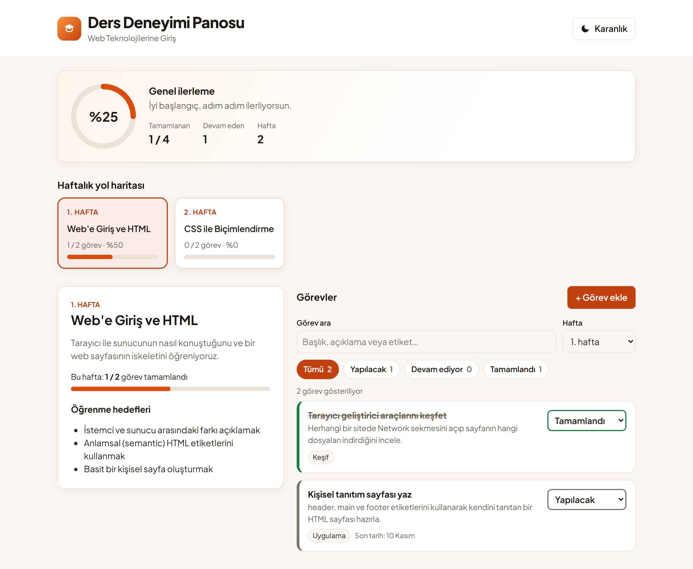
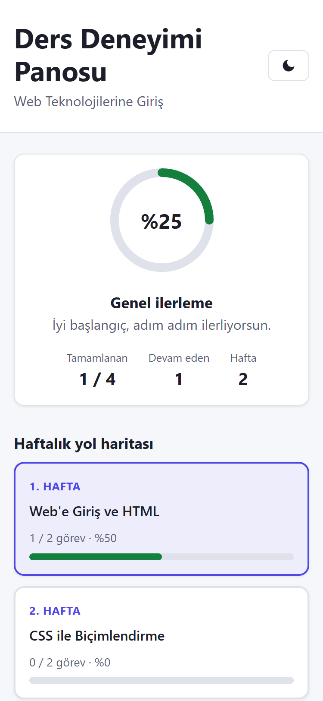
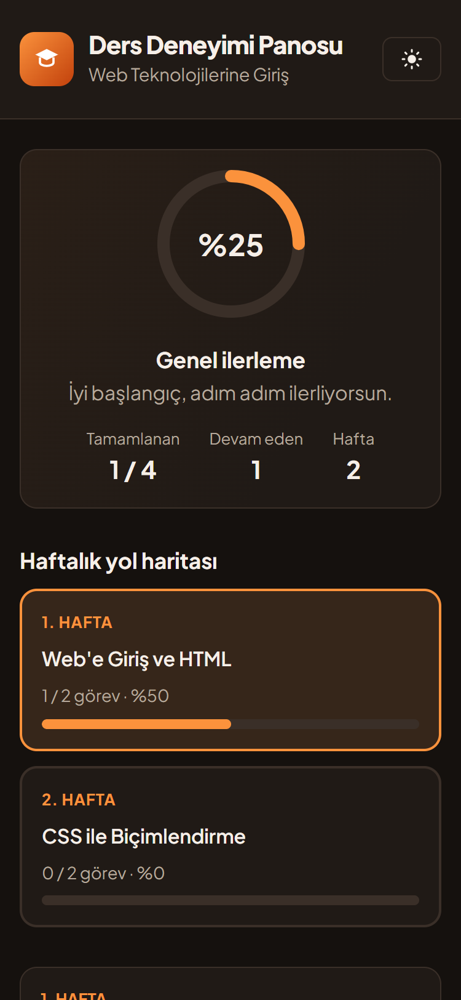

# Etkileşimli Ders Deneyimi Panosu

**Yazılım Geliştirme dersi — Proje 1 • Grup 6**

Öğrencilerin bir dersin haftalık akışını, öğrenme hedeflerini ve görevlerini tek ekranda görebildiği, görevleri tamamladıkça ilerlemesini görsel olarak takip edebildiği, mobilde de rahat kullanılan bir web panosu.

> **Durum:** Hafta 2 tamamlandı. Zorunlu özelliklerin hepsi çalışıyor; Hafta 3'te test kayıtları, örnek verinin tamamlanması ve hata düzeltmeleri yapılacak.



## İçindekiler

- [Proje amacı](#proje-amacı)
- [Ekip ve roller](#ekip-ve-roller)
- [Kullanılan teknolojiler](#kullanılan-teknolojiler)
- [Temel özellikler](#temel-özellikler)
- [Kurulum](#kurulum)
- [Çalıştırma](#çalıştırma)
- [Kullanım](#kullanım)
- [Proje yapısı](#proje-yapısı)
- [Çalışma düzeni](#çalışma-düzeni)
- [Demo ve ekran görüntüleri](#demo-ve-ekran-görüntüleri)
- [Proje takvimi](#proje-takvimi)
- [Bilinen eksikler](#bilinen-eksikler)

## Proje amacı

Öğrenciler ders içeriğini, görevlerini ve kendi ilerlemelerini genellikle farklı yerlerden takip ediyor. Bu pano; haftalık yol haritasını, her haftanın hedeflerini ve görevlerini bir arada gösterir, görev durumlarını değiştirmeye izin verir ve genel ilerlemeyi anında günceller.

Projenin odağı istemci tarafı web geliştirme, kullanılabilirlik ve etkileşim tasarımıdır. **Backend ve veri tabanı yoktur.** İçerik statik JSON dosyalarından okunur; öğrencinin ilerlemesi ve tercihleri tarayıcının `localStorage` alanında tutulur.

Panoda gösterilen ders (*Web Teknolojilerine Giriş*) kurgusal bir örnek derstir.

## Ekip ve roller

Tüm üyeler aynı zamanda geliştiricidir.

| Üye | Rol | GitHub |
|---|---|---|
| Çağrı Aydemir | Lider + Geliştirici | *(eklenecek)* |
| Caner Görez | Analist / Gereksinim + Geliştirici | *(eklenecek)* |
| Kamil Kurt | Test / Kalite + Geliştirici | *(eklenecek)* |
| Tunahan Akargül | Dokümantasyon / Sunum + Geliştirici | [@tunahan-akargul](https://github.com/tunahan-akargul) |

## Kullanılan teknolojiler

| Teknoloji | Kullanım amacı |
|---|---|
| [Vue 3](https://vuejs.org/) + TypeScript | Arayüz ve bileşenler |
| [Vite](https://vite.dev/) | Geliştirme sunucusu ve derleme |
| HTML, CSS (CSS değişkenleri) | Düzen, responsive tasarım ve tema |
| Statik JSON | Hafta ve görev içeriği |
| localStorage | Görev durumları ve kullanıcı tercihleri |
| Git / GitHub | Sürüm kontrolü, issue ve pull request |

Harici bir UI kütüphanesi kullanılmamıştır; tasarım kararları ekip tarafından verilmiştir.

## Temel özellikler

- [x] Haftalık ders kartları ve yol haritası
- [x] Hafta detayı: açıklama, öğrenme hedefleri ve haftalık ilerleme
- [x] Görev durumu değiştirme (yapılacak / devam ediyor / tamamlandı)
- [x] Öğrencinin kendi görevini ekleyip düzenleyebilmesi (form doğrulamalı)
- [x] Duruma ve haftaya göre filtreleme
- [x] Anahtar sözcükle arama (Türkçe karakter uyumlu)
- [x] Genel ilerleme halkası ve hafta bazlı ilerleme çubukları
- [x] Karanlık / aydınlık tema
- [x] Sayfa yenilense de durumun korunması (localStorage)
- [x] Responsive tasarım (mobil, tablet, masaüstü)
- [ ] Temel erişilebilirlik: yapı hazır, klavye ve kontrast kontrolü Hafta 3'te

## Kurulum

**Gereksinimler:** [Node.js](https://nodejs.org/) 22.18 veya üzeri (ya da 24.12+) ve Git.

```bash
# 1. Depoyu klonla
git clone https://github.com/tunahan-akargul/YG-Proje1-Grup6.git

# 2. Proje klasörüne gir
cd YG-Proje1-Grup6

# 3. Bağımlılıkları yükle
npm install
```

## Çalıştırma

```bash
# Geliştirme sunucusunu başlat
npm run dev
```

Terminalde yazan adresi (genellikle <http://localhost:5173>) tarayıcıda aç.

```bash
# Üretim derlemesi (tip kontrolü + derleme, çıktı dist/ klasörüne)
npm run build

# Derlenmiş sürümü yerelde önizle
npm run preview
```

## Kullanım

1. **Genel ilerleme:** Sayfanın üstündeki halka, bütün görevlerin yüzde kaçının tamamlandığını gösterir.
2. **Hafta seçimi:** *Haftalık yol haritası*ndaki bir karta tıkla. O haftanın açıklaması, hedefleri ve görevleri açılır.
3. **Görev durumu:** Görevin sağındaki listeden *Yapılacak*, *Devam ediyor* veya *Tamamlandı* seç. İlerleme göstergeleri anında güncellenir.
4. **Arama ve filtre:** *Görev ara* kutusuna yaz, durum düğmelerinden birini seç ya da *Hafta* listesinden *Tüm haftalar*ı seç.
5. **Kendi görevin:** *+ Görev ekle* ile yeni görev oluştur. Kendi eklediğin görevleri *Düzenle* ve *Sil* düğmeleriyle yönetebilirsin.
6. **Tema:** Sağ üstteki düğmeyle karanlık ve aydınlık tema arasında geçiş yap.

Bütün seçimler tarayıcıda saklanır; sayfa yenilense de korunur.

## Proje yapısı

```text
YG-Proje1-Grup6/
├─ README.md
├─ index.html
├─ src/
│  ├─ components/      # arayüz bileşenleri (WeekCard, TaskPanel, ProgressRing, ...)
│  ├─ composables/     # ortak mantık: useTasks, useFilters, useProgress, useTheme, useStorage
│  ├─ data/            # weeks.json, tasks.json (ders içeriği)
│  ├─ styles/          # tokens.css (renk/boşluk değişkenleri), base.css
│  ├─ types.ts         # veri modeli (Week, Task, TaskStatus)
│  ├─ App.vue
│  └─ main.ts
└─ docs/
   ├─ Hafta1_Rapor.docx
   ├─ Hafta2_Rapor.docx
   ├─ ekran-goruntuleri/
   └─ presentation/    # sunum dosyası
```

**Mantık ve görünüm ayrıdır:** `composables/` uygulamanın mantığını (durumlar, filtreleme, ilerleme hesabı, kalıcılık), `components/` ekranda görünen parçaları içerir.

## Çalışma düzeni

- Her üye kendi GitHub hesabıyla çalışır; görevler issue olarak açılır ve kişilere atanır.
- `main` dalı her zaman çalışır durumda tutulur. Değişiklikler `feature/...`, `fix/...` veya `docs/...` dallarında yapılır ve pull request ile birleştirilir.
- Commit mesajları yapılan değişikliği açıklar: `add week card component`, `fix search for Turkish characters`, `update readme with setup steps`.
- Gizli bilgi (anahtar, parola) repoya yazılmaz.

Ayrıntılar için [`docs/`](docs/) klasöründeki haftalık raporlara bakabilirsiniz.

## Demo ve ekran görüntüleri

**Canlı demo:** henüz yok. Uygulama [Kurulum](#kurulum) adımlarıyla yerelde çalıştırılabilir.

| Mobil — aydınlık | Mobil — karanlık |
|---|---|
|  |  |

Masaüstü karanlık tema: [`docs/ekran-goruntuleri/masaustu-karanlik.png`](docs/ekran-goruntuleri/masaustu-karanlik.png)

## Proje takvimi

| Hafta | Odak | Durum |
|---|---|---|
| 1 | İhtiyaç analizi, kullanıcı hikâyeleri, repository, görev planı | ✅ Tamamlandı |
| 2 | Arayüz/teknik tasarım, temel yapı ve ana işlevler | ✅ Tamamlandı |
| 3 | Entegrasyon, test kayıtları, hata düzeltme, örnek verinin tamamlanması | ⏳ Devam ediyor (geliştirme işleri öne çekildi) |
| 4 | Kalite kontrol, kullanıcı dokümanı, rapor, sunum ve demo | ⬜ |

## Bilinen eksikler

- Örnek ders verisi şimdilik 2 hafta / 4 görevden oluşuyor; 8 hafta / 20 göreve tamamlanacak.
- Klavyeyle tam gezinme ve renk kontrastı henüz elle kontrol edilmedi.
- Canlı demo bağlantısı yok.
